<a href="https://polinabobrova.com">
  <picture>
    <source media="(prefers-color-scheme: dark)" srcset="./banner.svg">
    <source media="(prefers-color-scheme: light)" srcset="./banner-light.svg">
    
  </picture>
</a>

 

I study how people understand emerging tech — then design and build products for them. 
7 years across web3, healthcare, e‑commerce and finance, from peer‑reviewed HCI research to shipped AI interfaces, hardware and brand.

 

 

## Projects

<table>
<tr><td colspan="3"><b>RESEARCH</b> — built to study how people use a technology</td></tr>
<tr>
<td width="26%"><a href="https://github.com/danserme/vera"><b>vera</b></a> · <a href="https://github.com/danserme/vera-api">api</a></td>
<td>Speech recognition for atypical Italian voices: patient datasets, model training, cloud inference, Android app.</td>
<td width="16%">Kotlin · Python</td>
</tr>
<tr>
<td><a href="https://github.com/danserme/impaired-speech-recog"><b>impaired-speech-recog</b></a></td>
<td>Whisper fine-tuned on impaired speech, running offline in real time.</td>
<td>Python</td>
</tr>
<tr>
<td><a href="https://github.com/danserme/cipher.pal"><b>cipher.pal</b></a> · <a href="https://github.com/danserme/cipher.pal-device">device</a></td>
<td>A fidget device for stress, with encrypted health data the user owns.</td>
<td>JavaScript · C++</td>
</tr>
<tr><td colspan="3"><b>APPS &amp; TOOLS</b></td></tr>
<tr>
<td><a href="https://github.com/danserme/murmur"><b>murmur</b></a></td>
<td>macOS app that transcribes and summarises speech on-device.</td>
<td>Swift</td>
</tr>
<tr>
<td><a href="https://github.com/danserme/plotline"><b>plotline</b></a></td>
<td>Project planning on a canvas instead of a checklist, with live collaboration, dependencies and timelines.</td>
<td>TypeScript</td>
</tr>
<tr><td colspan="3"><b>EXPERIMENTS</b></td></tr>
<tr>
<td><a href="https://github.com/danserme/AI-musicGen-glove"><b>AI-musicGen-glove</b></a></td>
<td>Fabric bend-sensor glove whose gestures drive sound synthesis in Pure Data.</td>
<td>C++</td>
</tr>
<tr>
<td><a href="https://github.com/danserme/rhythm-game"><b>rhythm-game</b></a></td>
<td>Drop in any song and get a beatmap, generated with librosa.</td>
<td>Python</td>
</tr>
<tr>
<td><a href="https://github.com/danserme/perceptron"><b>perceptron</b></a></td>
<td>A single-layer perceptron you can watch learn.</td>
<td>Processing</td>
</tr>
</table>

## Papers

<table>
<tr><td><b>A design toolkit for user acceptance and adoption</b></td><td>Universal Access in the Information Society</td></tr>
<tr><td><b>Restoring Data Sovereignty: A Human-Centered Approach to Blockchain Health Technology</b></td><td>ACM SPLASH Companion</td></tr>
<tr><td><b>CipherPal: A Privacy-Preserving Smart Fidget Device for Mindful Data Collection</b></td><td>ACM DIS Companion</td></tr>
<tr><td><b>Designing blockchain-based wearables for health monitoring</b></td><td>The Design Journal</td></tr>
</table>

Full list on [Google Scholar](https://scholar.google.com/citations?hl=en&user=7Ayj1TMAAAAJ).

## Stack

 

---

  <a href="https://polinabobrova.com">polinabobrova.com</a> &nbsp;·&nbsp;
  <a href="https://dribbble.com/danserme">Dribbble</a> &nbsp;·&nbsp;
  <a href="https://scholar.google.com/citations?hl=en&user=7Ayj1TMAAAAJ">Google Scholar</a>

